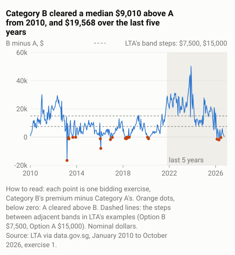
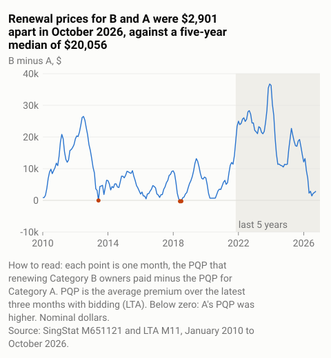

# COE Categories A and B: what the bidding record showed, January 2010 to October 2026

*Evidence note for LTA's public consultation on COE categorisation for cars (8 October to
2 November 2026). Written by Jacob, an independent researcher, in a personal capacity. The
code and data are public at https://github.com/jacobbuildmodel/coe-analysis (folder
`lta-ab`).*

This note sets out what the published record showed on four points the consultation paper raised. It covers every bidding exercise from January 2010 to October 2026, exercise 1. Amounts are in nominal dollars. The note takes no view on the proposal.

## 1. How often Category A cleared above Category B (Q1)

Of the 10 exercises from February to June 2026, Category A cleared above Category B in 3:
the second exercises of February, April and June 2026. This matches the paper: "from Feb to
Jun 2026, Category A price exceeded the Category B price on three occasions" (para 1.8).
Those 3 were the only such exercises among the 19 held in 2026 up
to the cut-off.

There were also 18 earlier occasions, in 2013, 2016-2018 and 2020. That makes 21 of the
397 exercises since January 2010. The largest margin was $16,599, in March 2013, exercise 1.

*What this shows and does not show:* it shows when the two clearing prices crossed. It does
not show why. Category A's criteria changed in 2014 and 2022 (para 1.6), so the two
categories did not hold the same cars throughout.

## 2. The B-A premium gap, beside LTA's example amounts (Q1, Q3)

Category B cleared a median $9,010 above A from 2010, and $19,568 over the last five years.
The paper named "the historical price gaps between Category A and Category B" as "one
possible reference point" for the feebate amounts (para 2.17). In its examples, adjacent
bands differ by $15,000 (Option A) or $7,500 (Option B). The lowest and highest bands
differ by $30,000 in both (paras 2.18(a)-(b)).

| B minus A, per exercise | From January 2010 | Last five years |
|---|---|---|
| Exercises | 397 | 120 |
| Median gap | $9,010 | $19,568 |
| Gap of $7,500 or more | 225 (57%) | 101 (84%) |
| Gap of $15,000 or more | 117 (29%) | 77 (64%) |
| Gap of $30,000 or more | 11 (3%) | 10 (8%) |

The last five years began in October 2021, exercise 2. Within them, the gap ran from
Category A $2,009 above B (April 2026) to Category B $50,335 above A. At the cut-off it was
$99.

*What this shows and does not show:* it shows that the size of the historical gap depended
on the window chosen. A premium is the price that cleared each category's own quota on one
day. It is not a measure of a car's value, and it does not show what the gap would be
within one merged pool.

## 3. Renewal prices: the PQP (Q4)

In October 2026, Category A's PQP was $128,715 and Category B's $131,616: $2,901 apart, or
2.3% of A's. The paper said that "existing owners of Category A and B cars already pay
broadly similar PQPs when renewing" (para 2.19).

- **Last 12 months:** median $4,930 (4% of A's PQP), between $1,390 and $16,941.
- **Last five years:** median $20,056 (22%), up to $36,738.
- **From 2010:** median $8,668 (15%).

Category A's PQP was at or above B's in 3 months: June 2013, June 2018 and July 2018. It
was in none of the last five years.

*What this shows and does not show:* it shows the gap between the two PQPs: 2.3% of A's in
October 2026, and a median monthly gap of 22% of A's over the last five years. It does not
show how many owners renewed, or what they would pay under a single PQP.

## 4. Quota shares and Category E (Q1, Q5)

**Quota.** Over the last five years, Category A held 58% of the combined A and B quota (57%
from 2010). Category E held 11% of A, B and E together (15% from 2010). Since May 2017,
Category E has received 10% of deregistrations from Categories A, B and C (footnote 5).

*What this shows and does not show:* how certificates were divided. Quota follows
deregistrations; it is not a measure of demand.

**Category E.** Over the last five years, Category E cleared at or above both A and B in 86
of 120 exercises, and below B in 34. Its median premium was $992 above B's.

*What this shows and does not show:* that E's price usually sat at or just above B's. It does not show who
used E certificates; the paper's statement that they went mostly to Category B cars
(para 2.22) cannot be checked from prices alone.

## Method and sources

- **Bidding results:** LTA via data.gov.sg (`d_69b3380ad7e51aff3a7dcc84eba52b8a`),
  downloaded 11 October 2026.
- **PQP:** SingStat table M651121 via data.gov.sg (`d_22094bf608253d36c0c63b52d852dd6e`),
  and LTA's "M11 COE Results 2025-2026".
- **Cross-checks:**
  - The bidding file matched the copy held since August in all 1,965 earlier rows.
  - Its Category A and B premiums matched SingStat's in all 394 exercises SingStat covers.
  - LTA's PQP, recomputed from premiums as a three-month average, matched all 392 published
    values to within $1.
- **Data corrections:** the two documented corrections to 2010 values in the repository
  README were applied. One is a Category B quota.
- **Reproduction:** every number in this note is produced by `lta-ab/10_facts.py` and
  checked against a number manifest.

## For the feedback form (three lines)

Category A cleared above B in 3 of 10 exercises from February to June 2026, as the paper states. There were 18 earlier occasions since 2010.
The B-A premium gap had a median of $9,010 from 2010 and $19,568 over the last five years, beside LTA's example band steps of $7,500 and $15,000.
In October 2026 the PQPs for A and B were $2,901 apart; their median gap over the last five years was $20,056. The note takes no view on the proposal. Note and data: https://github.com/jacobbuildmodel/coe-analysis (lta-ab).
