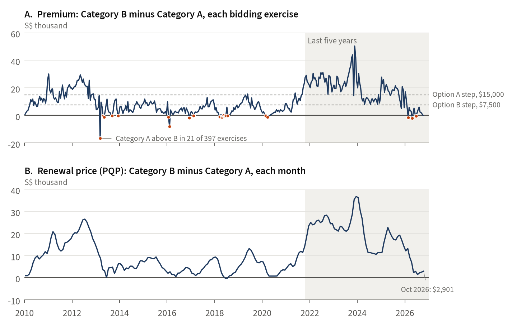

::: kicker
Submission to LTA's public consultation on COE categorisation for cars
:::

# COE Categories A and B: Evidence from the Bidding Record, 2010-2026

::: meta
**Jacob Ong**, independent researcher, writing in a personal capacity (ORCID 0009-0005-4438-9657).
Data and code: github.com/jacobbuildmodel/coe-analysis, folder lta-ab. Data to October 2026, first bidding exercise.
:::

::: summary
## Summary

- Category A cleared above Category B in 3 of the 10 bidding exercises from February to June 2026, consistent with paragraph 1.8 of the consultation paper, and in 21 of 397 exercises since January 2010.
- The median gap between the Category B and Category A premiums was $9,010 over 2010-2026 and $19,568 over the last five years. The consultation paper's example band steps are $7,500 and $15,000.
- In October 2026 the Prevailing Quota Premiums (PQP) for Categories A and B differed by $2,901 (2.3 per cent of A's). The median monthly difference over the last five years was $20,056 (22 per cent).
:::

## 1. Crossings of the Category A and B premiums

Paragraph 1.8 of the consultation paper states that "from Feb to Jun 2026, Category A price exceeded the Category B price on three occasions". The bidding record is consistent with this: Category A cleared above Category B in the second exercises of February, April and June 2026, and in none of the other 16 exercises held in 2026 up to the cut-off. Between January 2010 and October 2026, Category A cleared above Category B in 21 of 397 exercises, in 2013, 2016-2018, 2020 and 2026 (Figure 1, panel A). The largest margin was $16,599, in the first exercise of March 2013. Category A's eligibility criteria changed in 2014 and 2022 (para 1.6), so the composition of each category was not constant over the period.

## 2. The size of the gap between Categories A and B

Paragraph 2.17 identifies "the historical price gaps between Category A and Category B" as "one possible reference point" for the feebate amounts. Table 1 summarises the gap over two windows. Its median was $9,010 from 2010 and $19,568 over the last five years, and it was $15,000 or more in 29 per cent and 64 per cent of exercises respectively. Within the last five years it ranged from Category A $2,009 above B (April 2026) to Category B $50,335 above A; at the cut-off it was $99. A reference value drawn from the historical gap therefore depends materially on the window chosen.

Table 1. Category B premium minus Category A premium, per bidding exercise

| | January 2010 to October 2026 | Last five years |
|---|---|---|
| Exercises | 397 | 120 |
| Median gap | $9,010 | $19,568 |
| Gap of $7,500 or more | 225 (57%) | 101 (84%) |
| Gap of $15,000 or more | 117 (29%) | 77 (64%) |
| Gap of $30,000 or more | 11 (3%) | 10 (8%) |

Notes: The last five years run from October 2021 (exercise 2) to October 2026 (exercise 1). $7,500 and $15,000 are the steps between adjacent bands in the consultation paper's Options B and A; under both options the lowest and highest bands differ by $30,000 (paras 2.18(a)-(b)). Nominal dollars.

::: figure
Figure 1. Category B minus Category A, January 2010 to October 2026

Notes: Panel A shows each bidding exercise; red markers denote exercises in which Category A cleared above Category B. Dashed lines mark the band steps in the consultation paper's examples (para 2.18). Panel B shows the monthly PQP. Shading marks the last five years. Nominal dollars. Sources: LTA via data.gov.sg; SingStat table M651121; LTA, M11 COE Results 2025-2026; author's calculations.
:::

## 3. Renewal prices

Paragraph 2.19 states that owners of Category A and B cars "already pay broadly similar PQPs when renewing". In October 2026 the PQP was $128,715 for Category A and $131,616 for Category B, a difference of $2,901, or 2.3 per cent of Category A's. Over the preceding 12 months the median monthly difference was $4,930 (4 per cent, ranging from $1,390 to $16,941). Over the last five years it was $20,056 (22 per cent, with a maximum of $36,738), and since 2010 it was $8,668 (15 per cent) (Figure 1, panel B). Category A's PQP was at or above Category B's in three months, June 2013, June 2018 and July 2018, and in none of the last five years.

## 4. Quota shares and Category E

Over the last five years Category A received 58 per cent of the combined Category A and B quota (57 per cent since 2010), and Category E received 11 per cent of the combined A, B and E quota (15 per cent since 2010). Category E cleared at or above both Categories A and B in 86 of the last 120 exercises and below Category B in 34; its median premium was $992 above Category B's.

## Scope

The figures describe clearing prices and quotas. A premium is the price that cleared one category's quota in one exercise; it is not a measure of vehicle value, and it does not indicate what prices would be in a merged pool. The data do not show renewal volumes, or which vehicles were registered with Category E certificates (para 2.22). This note takes no view on the proposals.

## Data and method

::: method
- **Bidding results:** LTA via data.gov.sg (dataset d_69b3380ad7e51aff3a7dcc84eba52b8a), retrieved 11 October 2026.
- **PQP:** SingStat table M651121 via data.gov.sg (dataset d_22094bf608253d36c0c63b52d852dd6e) and LTA, M11 COE Results 2025-2026.
- **Cross-checks:** the bidding file matched an earlier copy in all 1,965 overlapping rows; its Category A and B premiums matched SingStat in all 394 exercises SingStat covers; the PQP, recomputed as a three-month average of premiums, matched all 392 published values to within $1. Two documented corrections to 2010 values were applied.
- **Reproduction:** every figure in this note is produced by lta-ab/10_facts.py and checked against a number manifest.
:::

## For the feedback form (three lines)

Category A cleared above B in 3 of 10 exercises from February to June 2026, as the paper states. There were 18 earlier occasions since 2010.
The B-A premium gap had a median of $9,010 from 2010 and $19,568 over the last five years, beside LTA's example band steps of $7,500 and $15,000.
In October 2026 the PQPs for A and B were $2,901 apart; their median gap over the last five years was $20,056. The note takes no view on the proposal. Note and data: https://github.com/jacobbuildmodel/coe-analysis (lta-ab).
